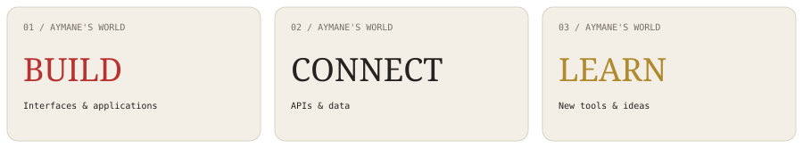
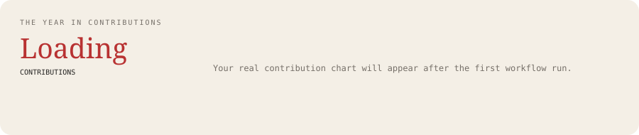

*Learn with curiosity. Build with purpose. Improve with every commit.*

---

## Three worlds

## A little about me

I'm **Aymane Chokri**, a web developer interested in building useful, accessible and well-crafted web applications. I enjoy working across the frontend, connecting applications to APIs, and learning the engineering behind reliable products.

- **Currently exploring:** React, JavaScript, PHP, Laravel and MySQL
- **Enjoy:** turning ideas into practical projects, debugging and continuous learning
- **Based in:** Morocco
- **Open to:** collaboration, learning opportunities and internships

## Selected work

<table>
<tr>
<td width="50%" valign="top">

### [DevScope](https://github.com/aymanechoukri/DevScope)

A GitHub developer discovery app: explore profiles and public repositories, then manage a shortlist of candidates.

JavaScript · GitHub API · REST API

</td>
<td width="50%" valign="top">

### [Internship Platform](https://github.com/aymanechoukri/internship-platform-frontend)

A platform frontend with student and company experiences, dashboards and application workflows.

React · Vite · Tailwind CSS

</td>
</tr>
<tr>
<td width="50%" valign="top">

### [Internship Platform Backend](https://github.com/aymanechoukri/internship-platform-backend)

Backend repository for the internship platform project.

</td>
<td width="50%" valign="top">

### [Tachkila](https://github.com/aymanechoukri/Tachkila-v2-Effectif-Matchs)

A football project focused on team composition and match information.

</td>
</tr>
</table>

[Explore all repositories →](https://github.com/aymanechoukri?tab=repositories)

## Activity, in red

Contribution cards are refreshed daily by GitHub Actions. The first successful workflow run will populate the live contribution data.

## Toolkit

## Certifications

- [Responsive Web Design — freeCodeCamp](https://www.freecodecamp.org/certification/aymanchokri/responsive-web-design-v9)
- [JavaScript Algorithms and Data Structures — freeCodeCamp](https://www.freecodecamp.org/certification/aymanchokri/javascript-v9)

---

**Have an idea? Let's build something useful.**

<a href="mailto:aymanedivl@gmail.com">Email</a> · <a href="https://github.com/aymanechoukri">GitHub</a>

Made with curiosity and a little bit of red.

